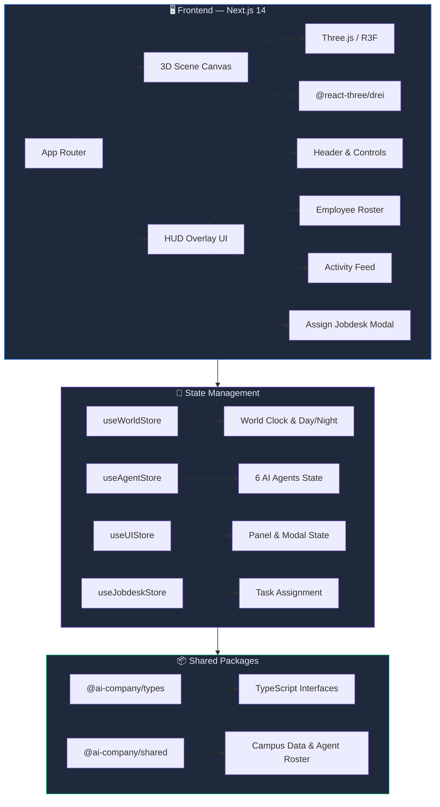
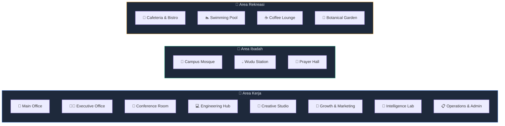

<div align="center">

# 🏢 AI Virtual Company

### 3D AI-Powered Office Simulation

> **Simulasi kantor virtual 3D berbasis web di mana karyawan AI otonom bekerja, berkolaborasi, beribadah, dan menjalankan rutinitas harian secara real-time.**

[](https://nextjs.org/)
[](https://threejs.org/)
[](https://reactjs.org/)
[](https://www.typescriptlang.org/)
[](https://zustand-demo.pmnd.rs/)
[](https://tailwindcss.com/)
[](LICENSE)

---

</div>

---

## 📋 Daftar Isi

- [🌟 Tentang Project](#-tentang-project)
- [✨ Fitur Utama](#-fitur-utama)
- [📸 Screenshots](#-screenshots)
- [🏗️ Arsitektur & Tech Stack](#️-arsitektur--tech-stack)
- [📁 Struktur Folder](#-struktur-folder)
- [🚀 Cara Menjalankan](#-cara-menjalankan)
- [⚙️ Konfigurasi Environment](#️-konfigurasi-environment)
- [🤖 AI Agents (Karyawan Virtual)](#-ai-agents-karyawan-virtual)
- [🗺️ Peta Kampus Virtual](#️-peta-kampus-virtual)
- [🕌 Sistem Jadwal Sholat](#-sistem-jadwal-sholat)
- [🎮 Kontrol Simulasi](#-kontrol-simulasi)
- [🛣️ Roadmap](#️-roadmap)
- [🤝 Kontribusi](#-kontribusi)
- [📄 Lisensi](#-lisensi)

---

## 🌟 Tentang Project

**AI Virtual Company** adalah simulasi kantor virtual 3D berbasis web yang menampilkan karyawan AI otonom dalam lingkungan kampus perusahaan. Setiap AI Agent memiliki kepribadian, keahlian, dan rutinitas unik — mereka bekerja, meeting, istirahat, makan di kafetaria, berenang, bersantai di lounge, dan melaksanakan sholat di masjid kampus secara otomatis.

Project ini dibangun dengan pendekatan **local-first** tanpa memerlukan VPS — cukup jalankan di komputer lokal dan seluruh simulasi berjalan langsung di browser.

### 💡 Inspirasi

Terinspirasi dari konsep **AI Town** dan simulasi agen otonom, project ini menghadirkan nuansa yang lebih dekat dengan budaya kerja Indonesia — termasuk integrasi jadwal sholat 5 waktu dan arsitektur kampus yang mencerminkan lingkungan kerja modern di Indonesia.

---

## ✨ Fitur Utama

<table>
  <tr>
    <td align="center" width="33%">
      <h3>🏢 Kampus 3D Interaktif</h3>
      <p>Gedung kantor, masjid, kafetaria, kolam renang, lounge, dan taman botani — semua dirender dalam 3D real-time dengan detail interior.</p>
    </td>
    <td align="center" width="33%">
      <h3>🤖 AI Agents Otonom</h3>
      <p>6 karyawan AI dengan kepribadian unik yang bekerja, berpindah lokasi, dan menjalankan tugas secara mandiri.</p>
    </td>
    <td align="center" width="33%">
      <h3>🌅 Day/Night Cycle</h3>
      <p>Sistem pencahayaan dinamis yang berubah secara real-time mengikuti waktu simulasi — dari fajar hingga malam hari.</p>
    </td>
  </tr>
  <tr>
    <td align="center" width="33%">
      <h3>🕌 Jadwal Sholat</h3>
      <p>Integrasi sholat 5 waktu (Subuh, Dzuhur, Ashar, Maghrib, Isya) — agent otomatis wudhu dan sholat berjamaah.</p>
    </td>
    <td align="center" width="33%">
      <h3>⏱️ Kontrol Waktu</h3>
      <p>Pause, 1x, 2x, 5x, 10x speed multiplier untuk mempercepat atau memperlambat simulasi sesuai kebutuhan.</p>
    </td>
    <td align="center" width="33%">
      <h3>📋 Assign Jobdesk</h3>
      <p>Modal interaktif untuk memberikan tugas baru kepada agent AI dengan prioritas dan deskripsi detail.</p>
    </td>
  </tr>
  <tr>
    <td align="center" width="33%">
      <h3>📊 HUD Command Center</h3>
      <p>Overlay UI glassmorphism premium dengan activity feed, employee roster, dan panel detail agent.</p>
    </td>
    <td align="center" width="33%">
      <h3>🎥 Kamera Isometrik</h3>
      <p>OrbitControls halus dengan batas sudut dan collision — pandangan isometrik yang nyaman untuk eksplorasi.</p>
    </td>
    <td align="center" width="33%">
      <h3>🌐 Zero-VPS</h3>
      <p>Arsitektur local-first — jalankan seluruh simulasi di laptop tanpa server. Opsional Cloudflare Tunnel untuk sharing.</p>
    </td>
  </tr>
</table>

---

## 📸 Screenshots

<div align="center">

<!-- 🖼️ SCREENSHOT: Ganti 2 URL di bawah dengan screenshot mode siang & malam -->

### ☀️ Mode Siang &nbsp;&nbsp;|&nbsp;&nbsp; 🌙 Mode Malam
<p>
  
  
</p>

</div>

---

## 🏗️ Arsitektur & Tech Stack



### Tech Stack Detail

| Layer | Teknologi | Keterangan |
|-------|-----------|------------|
| **3D Engine** | Three.js, React Three Fiber, @react-three/drei | Render 3D real-time di browser |
| **Framework** | Next.js 14 (App Router) | Server-side rendering & routing |
| **UI Library** | React 18 | Komponen UI reaktif |
| **Language** | TypeScript 5.6 | Type-safe development |
| **Styling** | Tailwind CSS 3.4 | Utility-first CSS framework |
| **State** | Zustand 4.5 | Lightweight state management |
| **Icons** | Lucide React | Icon library modern |
| **Monorepo** | npm Workspaces | Multi-package architecture |

---

## 📁 Struktur Folder

```
ai-virtual-company/
├── 📂 apps/
│   └── 📂 web/                          # Next.js frontend application
│       ├── 📂 3d/                        # 3D world components
│       │   ├── SceneCanvas.tsx           # Root 3D canvas & scene setup
│       │   ├── 📂 camera/               # Kamera & OrbitControls
│       │   ├── 📂 characters/           # Agent 3D characters
│       │   │   ├── EmployeeCharacter3D.tsx
│       │   │   └── EmployeeSimulationManager.tsx
│       │   ├── 📂 environments/         # Pencahayaan & day/night cycle
│       │   │   └── DayNightLighting.tsx
│       │   └── 📂 world/               # Building & campus meshes
│       │       ├── CampusGround.tsx
│       │       ├── CityRoadsAndParking.tsx
│       │       ├── DetailedAmenities.tsx
│       │       ├── DetailedMosqueInterior.tsx
│       │       ├── DetailedOfficeInterior.tsx
│       │       └── LocationLabel3D.tsx
│       ├── 📂 app/                       # Next.js App Router
│       │   ├── globals.css
│       │   ├── layout.tsx
│       │   └── page.tsx                  # Halaman utama simulasi
│       ├── 📂 components/overlay/        # HUD UI overlay components
│       │   ├── ActivityFeed.tsx          # Log aktivitas real-time
│       │   ├── AssignJobdeskModal.tsx     # Modal assign tugas ke agent
│       │   ├── EmployeeRoster.tsx        # Daftar karyawan AI
│       │   ├── Header.tsx                # Header & company info
│       │   ├── LoadingScreen.tsx         # Layar loading animasi
│       │   ├── SelectedAgentPanel.tsx    # Panel detail agent terpilih
│       │   └── TimeControls.tsx          # Kontrol kecepatan simulasi
│       └── 📂 stores/                    # Zustand state stores
│           ├── useAgentStore.ts          # State 6 AI agents
│           ├── useJobdeskStore.ts        # State manajemen tugas
│           ├── useUIStore.ts             # State UI panels & modals
│           └── useWorldStore.ts          # State world clock & lighting
├── 📂 packages/
│   ├── 📂 shared/                        # Shared constants & data
│   │   └── src/index.ts                  # Campus locations, agents, prayer schedule
│   └── 📂 types/                         # Shared TypeScript types
│       └── src/index.ts                  # Agent, Task, WorldClock, etc.
├── .env.example                          # Template environment variables
├── package.json                          # Root monorepo config
└── README.md                             # Dokumentasi ini
```

---

## 🚀 Cara Menjalankan

### Prasyarat

- **Node.js** >= 18.0.0
- **npm** >= 9.0.0
- Browser modern dengan dukungan **WebGL 2** (Chrome, Firefox, Edge, Safari)

### 1. Clone Repository

```bash
git clone https://github.com/USERNAME/ai-virtual-company.git
cd ai-virtual-company
```

> ⚠️ Ganti `USERNAME` dengan username GitHub kamu.

### 2. Setup Environment

```bash
cp .env.example .env
```

Edit file `.env` sesuai kebutuhan (lihat bagian [Konfigurasi Environment](#️-konfigurasi-environment)).

### 3. Install Dependencies

```bash
npm install
```

### 4. Jalankan Development Server

```bash
npm run dev
```

### 5. Buka di Browser

```
🌐 http://localhost:3000
```


---

## ⚙️ Konfigurasi Environment

Buat file `.env` dari template:

```bash
cp .env.example .env
```

### Environment Variables

| Variable | Default | Keterangan |
|----------|---------|------------|
| `DATABASE_URL` | `postgresql://...` | URL koneksi PostgreSQL (untuk fase mendatang) |
| `AI_PROVIDER` | `simulation` | Mode AI: `simulation`, `gemini`, atau `openai` |
| `GEMINI_API_KEY` | — | API key Google Gemini (opsional) |
| `OPENAI_API_KEY` | — | API key OpenAI (opsional) |
| `NEXT_PUBLIC_APP_URL` | `http://localhost:3000` | URL aplikasi frontend |
| `NEXT_PUBLIC_WEBSOCKET_URL` | `ws://localhost:3001` | URL WebSocket server |
| `COMPANY_NAME` | `AI Virtual Company` | Nama perusahaan yang ditampilkan |
| `COMPANY_TIMEZONE` | `Asia/Jakarta` | Timezone untuk jadwal sholat |
| `PRAYER_LATITUDE` | `-6.2088` | Latitude untuk kalkulasi waktu sholat |
| `PRAYER_LONGITUDE` | `106.8456` | Longitude untuk kalkulasi waktu sholat |
| `CLOUDFLARE_TUNNEL_TOKEN` | — | Token Cloudflare Tunnel (opsional, untuk sharing) |

---

## 🤖 AI Agents (Karyawan Virtual)

Kampus virtual ini dihuni oleh **6 AI Agent** dengan peran, kepribadian, dan keahlian unik:

| Avatar | Nama | Jabatan | Departemen | Keahlian Utama |
|--------|------|---------|------------|----------------|
| 🟣 | **Arya Pratama** | Manager | Management | Strategic Planning, Orchestration, Task Review |
| 🔵 | **Bima Satria** | Developer | Engineering | TypeScript, React/Next.js, Node.js, OpenCode CLI |
| 🩷 | **Maya Lestari** | Designer | Design & Creative | UI/UX Design, 3D Aesthetics, Design Systems |
| 🟡 | **Ryan Hidayat** | Marketing | Growth & Marketing | Growth Strategy, SEO, Content Marketing |
| 🟢 | **Sarah Wijaya** | Researcher | Intelligence & Research | Market Intelligence, LLM Benchmarking, Data Synthesis |
| ⚪ | **Dika Nugraha** | Admin | Operations & Admin | Workflow Automation, Scheduling, Resource Tracking |

### Status Agent

Setiap agent memiliki status yang berubah secara dinamis:

```
🟢 WORKING    — Sedang mengerjakan tugas
🔵 WALKING    — Berpindah lokasi
🟡 THINKING   — Sedang berpikir/menganalisis
🟣 MEETING    — Rapat di conference room
🟠 EATING     — Makan di kafetaria
☕ DRINKING   — Minum di lounge
🏊 SWIMMING   — Berenang di kolam
💧 WUDU       — Berwudhu
🕌 PRAYING    — Sedang sholat
😴 RESTING    — Istirahat
⚪ IDLE       — Menunggu tugas
🔴 OFFLINE    — Tidak aktif
```

---

## 🗺️ Peta Kampus Virtual

Kampus virtual mencakup **15 lokasi** yang dikelompokkan dalam 5 kategori:



---

## 🕌 Sistem Jadwal Sholat

Seluruh AI Agent menjalankan sholat 5 waktu secara otomatis:

| Waktu | Jam | Durasi | Alur |
|-------|-----|--------|------|
| 🌅 **Subuh** (Fajr) | 04:45 | 20 menit | Agent → Wudu Station → Prayer Hall → Kembali kerja |
| ☀️ **Dzuhur** (Dhuhr) | 12:05 | 30 menit | Agent → Wudu Station → Prayer Hall → Kembali kerja |
| 🌤️ **Ashar** (Asr) | 15:15 | 25 menit | Agent → Wudu Station → Prayer Hall → Kembali kerja |
| 🌅 **Maghrib** | 18:00 | 20 menit | Agent → Wudu Station → Prayer Hall → Kembali kerja |
| 🌙 **Isya** (Isha) | 19:15 | 25 menit | Agent → Wudu Station → Prayer Hall → Kembali kerja |

> 📍 Waktu sholat dikonfigurasi berdasarkan koordinat lokasi (default: **Jakarta, Indonesia**).

---

## 🎮 Kontrol Simulasi

### Kontrol Waktu

| Tombol | Fungsi |
|--------|--------|
| ⏸️ **Pause** | Hentikan simulasi |
| ▶️ **1x** | Kecepatan normal (real-time) |
| ⏩ **2x** | 2x lebih cepat |
| ⏩ **5x** | 5x lebih cepat |
| ⏩ **10x** | 10x lebih cepat |

### Kontrol Kamera

| Input | Aksi |
|-------|------|
| 🖱️ **Klik Kiri + Drag** | Rotasi kamera |
| 🖱️ **Klik Kanan + Drag** | Geser (pan) kamera |
| 🖱️ **Scroll** | Zoom in / out |
| 🖱️ **Klik Agent** | Pilih & lihat detail agent |

### Kontrol Mode Pencahayaan

| Mode | Keterangan |
|------|------------|
| ☀️ **Day** | Pencahayaan siang hari |
| 🌙 **Night** | Pencahayaan malam hari |
| 🔄 **Realtime** | Sinkron dengan waktu simulasi |

---

## 🛣️ Roadmap

- [x] 🏢 3D Campus dengan interior kantor dan masjid
- [x] 🤖 6 AI Agent dengan kepribadian unik
- [x] 🌅 Sistem Day/Night cycle dinamis
- [x] 🕌 Jadwal sholat otomatis dengan wudhu
- [x] ⏱️ Time controls (pause, 1x, 2x, 5x, 10x)
- [x] 📊 HUD Command Center overlay
- [x] 📋 Assign Jobdesk modal
- [x] 🎥 Isometric camera controls
- [ ] 🧠 Integrasi AI Provider (Gemini / OpenAI) untuk pengambilan keputusan agent
- [ ] 🔌 WebSocket real-time server untuk multi-agent communication
- [ ] 💬 Chat system antar agent
- [ ] 📈 Dashboard analytics & productivity metrics
- [ ] 🎵 Ambient sound & notification audio
- [ ] 📱 Responsive mobile view
- [ ] 🌐 Cloudflare Tunnel deployment support
- [ ] 🗄️ PostgreSQL persistence untuk state & history

---

## 🤝 Kontribusi

Kontribusi sangat diterima! Silakan ikuti langkah-langkah berikut:

1. **Fork** repository ini
2. Buat **branch** fitur baru:
   ```bash
   git checkout -b feature/fitur-baru-anda
   ```
3. **Commit** perubahan:
   ```bash
   git commit -m "feat: tambahkan fitur baru"
   ```
4. **Push** ke branch:
   ```bash
   git push origin feature/fitur-baru-anda
   ```
5. Buat **Pull Request**

### Commit Convention

```
feat:     Fitur baru
fix:      Perbaikan bug
docs:     Perubahan dokumentasi
style:    Perubahan formatting (tidak mempengaruhi kode)
refactor: Refactoring kode
perf:     Peningkatan performa
test:     Menambah atau memperbaiki test
chore:    Maintenance task
```

---

## 📄 Lisensi

Project ini dilisensikan di bawah **MIT License** — lihat file [LICENSE](LICENSE) untuk detail.

---

<div align="center">

### 🌟 Jika project ini bermanfaat, berikan ⭐ di GitHub!

**Dibuat dengan ❤️ menggunakan Next.js, Three.js, dan AI**


</div>
